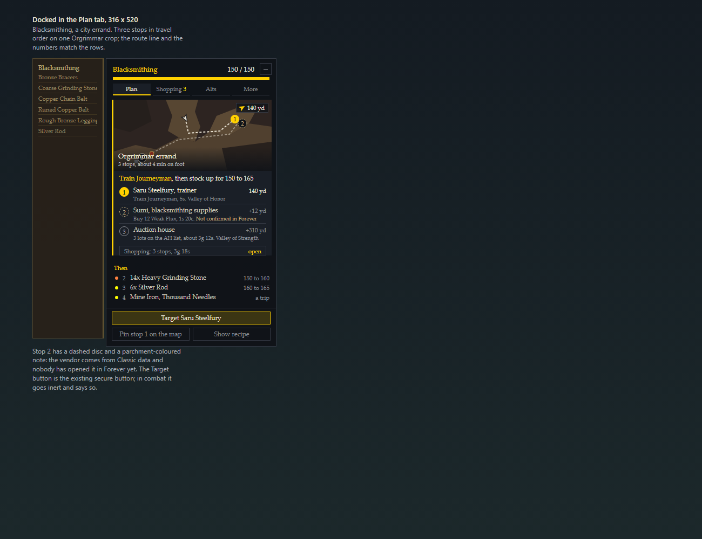
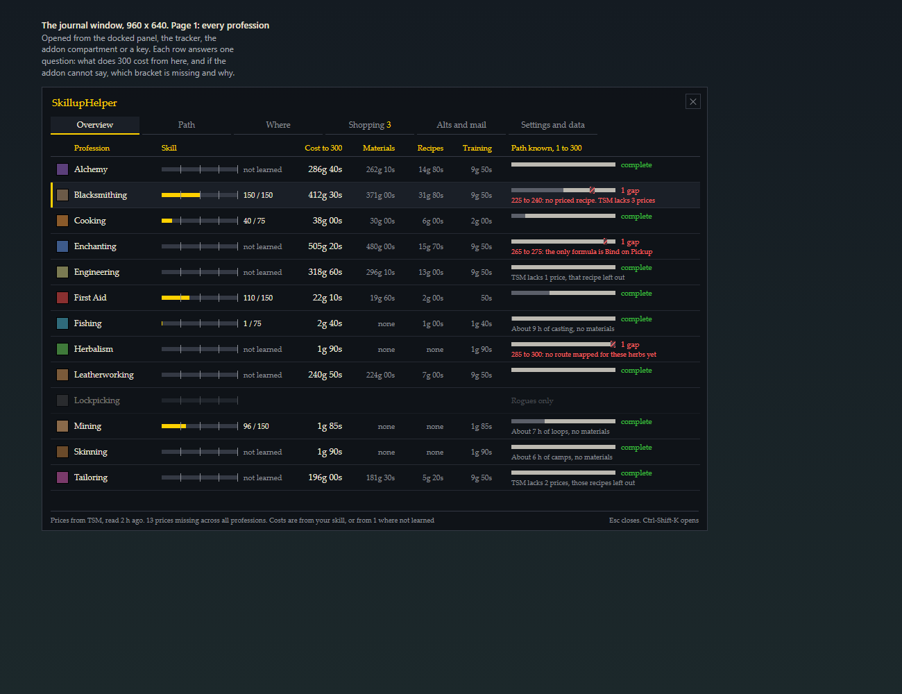
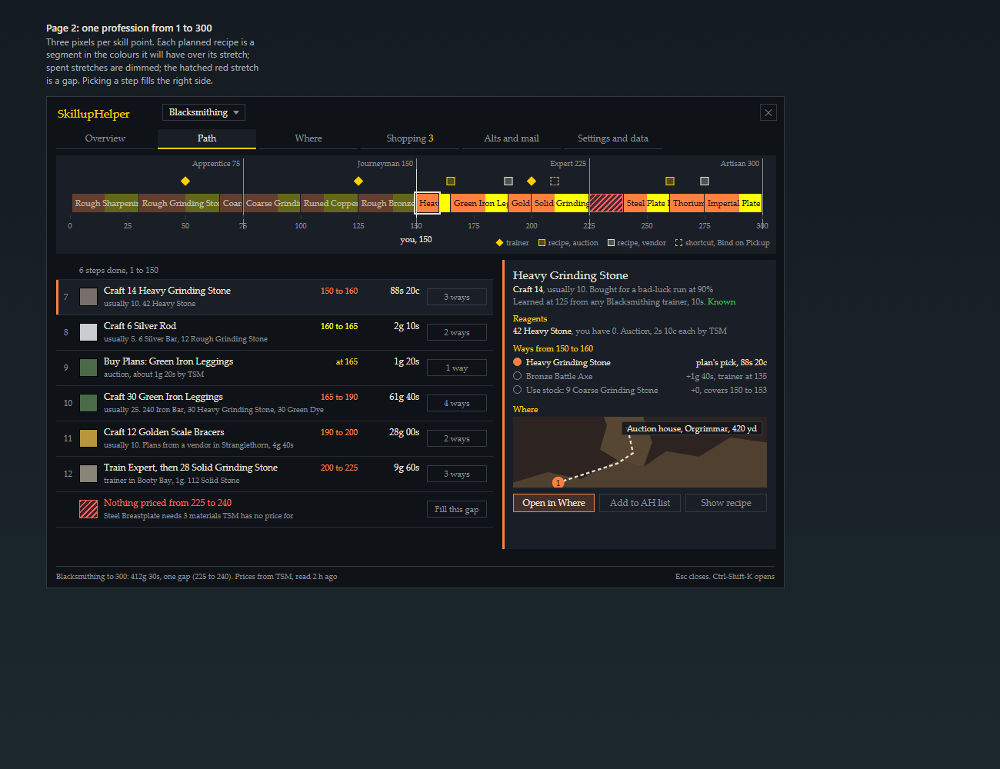
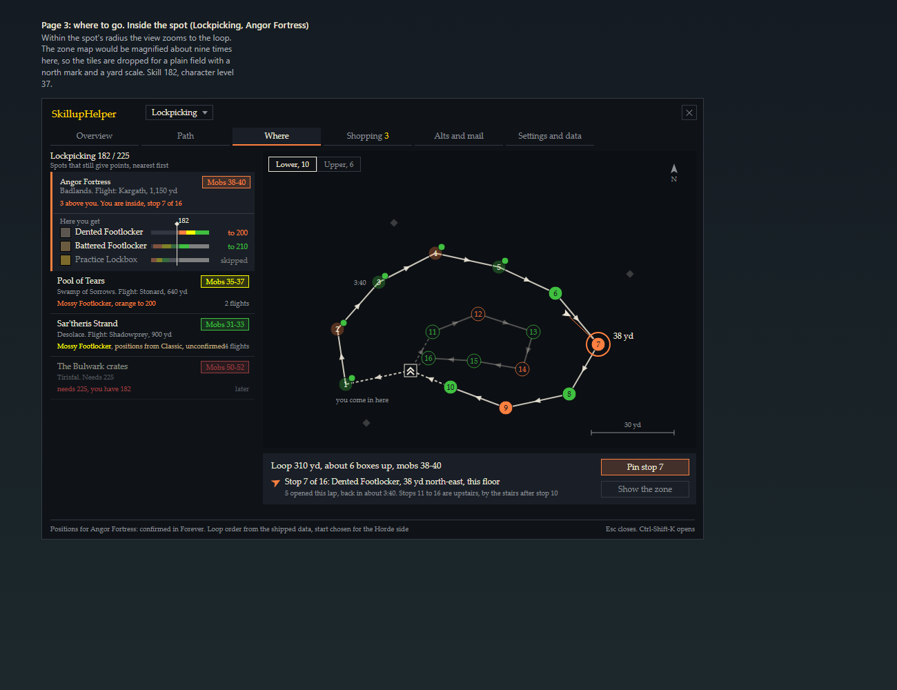
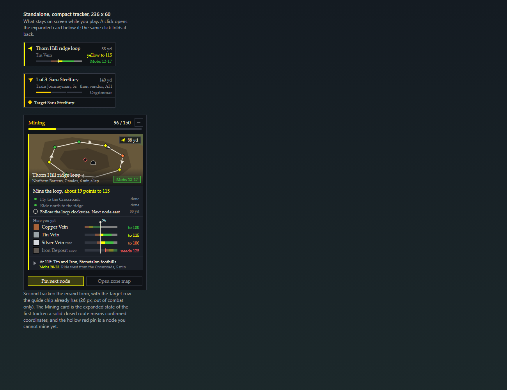
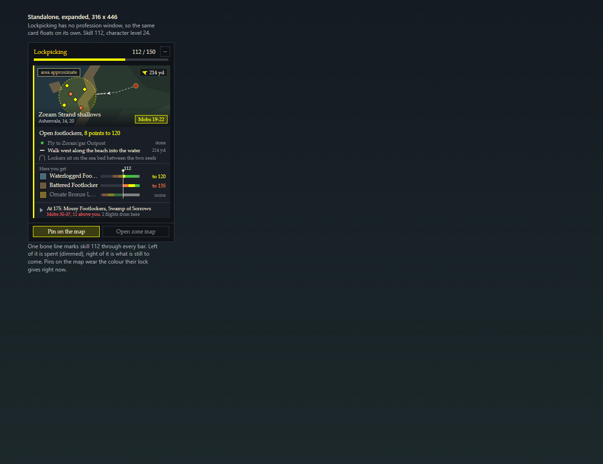
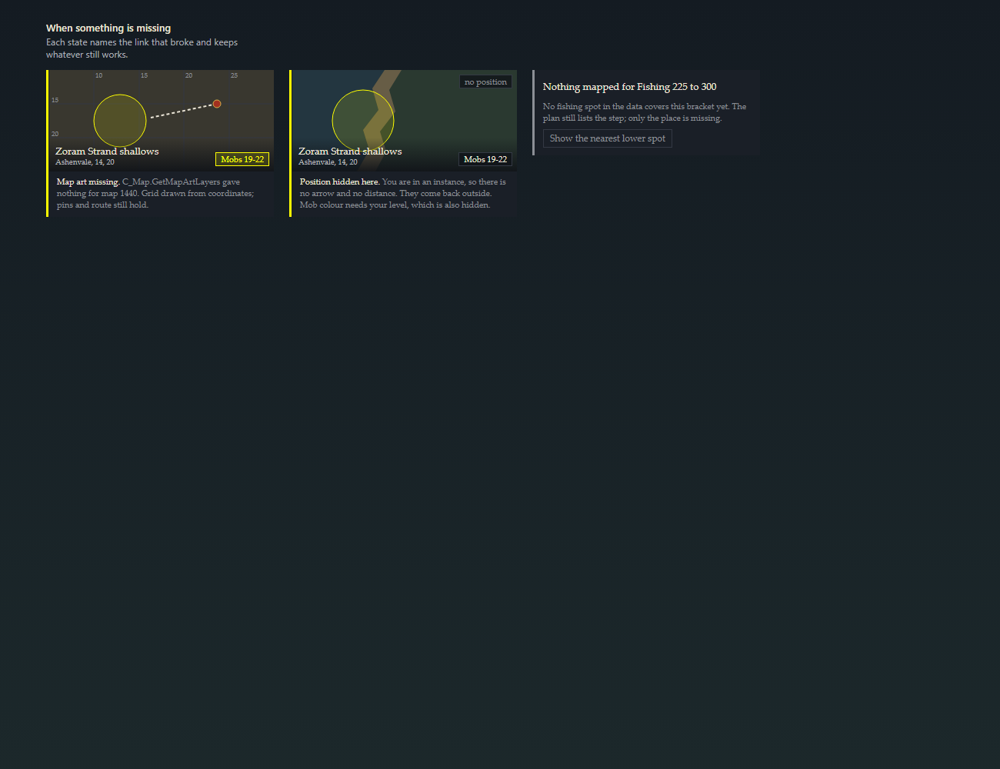

# Skillup Helper

Levels your professions to 300 for the least gold, for WoW: Forever.

- At the profession window it says what to craft next, what to buy and where, and what it costs.
- A journal shows every profession at once: what reaching 300 costs from your skill, the path step by step, and
  which stretch the addon cannot plan yet, with the reason.
- For the skills you level out in the world (Mining, Herbalism, Skinning, Fishing, Lockpicking) it says where to go
  and walks you round the loop with a small tracker.

Beta. It runs on Forever (interface 16001) only. Some data is from Classic and not yet checked in Forever; the
"Limits" section lists what.

## What you see

All pictures below are **design previews with placeholder data**, drawn from the design mockup. In-game
screenshots will replace them (the list is in [docs/screenshots.md](docs/screenshots.md)).

**The panel at the profession window.** It docks beside TradeSkillMaster's crafting window or Blizzard's own and
follows you when you switch. It shows one thing: what to do now (what to craft, how many, why, where to go and
what it costs), the next three steps, and a strip of the whole path with a mark where you are. Everything else is
in the journal: the button at the bottom of the panel opens it. Nothing in the addon scrolls; long lists turn
pages.

**The journal.** One window with six pages: Overview (every profession and its cost to 300), Path (one profession
from 1 to 300 as a timeline and a list of steps), Where (places for world skills, with the map), Shopping, Alts and
mail, and Settings and data.

**The tracker and the field card.** Pick a spot on the Where page and press "Track this spot". A 236 x 60 tracker
stays on screen with the next stop, the distance and the arrow. A click opens the card with the map. The choice is
kept per character, so a rogue keeps a Lockpicking loop and a herbalist a herb route. While the tracker is up, the
small guide chip that points to vendors and trainers steps aside, so there is only ever one of them.

When something is missing (no prices, no position in a dungeon, a map without art) the page says what broke and
keeps what still works.

## Opening it

| How | Opens |
|---|---|
| The three-line button on the docked panel | the journal at the profession you have open |
| The minimap button (drag it round the edge; right-click for a menu; `/skillup minimap` hides or shows it) | the journal, or closes it |
| The addon menu by the minimap (the addon compartment) | the journal, or closes it |
| A key: Key Bindings > AddOns > "Open the SkillupHelper journal", or Settings and data > Key | the journal |
| `/skillup journal` (`/skillup journal where` opens that page) | the journal |
| `/skillup` | shows or hides the docked panel; with no profession window open, the journal |

The other slash commands still work. Each one is also a control on the journal's Settings page and writes the same
setting: `/skillup luck 95`, `/skillup effort 30`, `/skillup recipes off`, `/skillup exclude dungeon|ahpatterns|special|<spellID>`,
`/skillup allow <spellID>`, `/skillup cost [profession]`, `/skillup ranks`.

## Install

1. Install TradeSkillMaster (required).
2. Put the `SkillupHelper` folder in `World of Warcraft\_forever_\Interface\AddOns\`.
3. Start the game. A new addon folder is only seen at start, so `/reload` is not enough the first time.

On the first login after an install or update, one chat line says where the journal is and the button on the
docked panel pulses until you click it.

## Prices and TradeSkillMaster

Prices come from TradeSkillMaster in game (AuctionDB: market value, then minimum buyout, then the region average).

Without TSM price data the addon still works. The journal's status line says so and tells you what to do: let the
TSM desktop app sync, or scan the auction house once in TSM, then reopen the window. Until then:

- Costs count vendor-sold items (their prices ship with the data). Auction items count as unpriced, and each
  profession's row says how many prices are missing, so the totals are too low until TSM has data.
- Paths, gaps, trainers, recipe sources, the Where page and the tracker do not use prices and work the same.

## How the plan is made

These rules hold for every plan, every replan and every alternative the panel offers:

1. **Buy for bad luck.** A step that buys reagents buys enough for a bad-luck run: the 90th percentile of the crafts
   it takes to reach the step's target, not the average. The card says "usually N crafts, up to M". A lucky run ends
   early and the spares count as stock for later steps. `/skillup luck 95` changes the percentile (50, 75, 80, 90, 95
   or 99).
2. **Earmarked materials stay put.** A material a later step needs is never offered for something else: not as "Or use
   stock", not in the from-stock list as "ok", and not by a replan. Only true spares are offered.
3. **A bought step holds.** Once a step is on your AH list, its recipe and target hold until you reach the target or
   the recipe turns grey. A replan after a skill-up or a price change never switches or shrinks it.
4. **One recipe, one step.** A recipe's crafts stay one step even when part comes from stock and part is bought.
5. **No one-craft detours.** A single point of another recipe between two runs of the same recipe is folded in,
   unless it saves at least 10% of the remaining cost.
6. **Caps are planned.** The live cap comes from the client; ranks above it come from what the addon read at a
   profession trainer, or the usual ranks (75, 150, 225, 300) until then. A rank-up goes between its unlock skill and
   the cap and never splits a craft run. A rank your character level can't train yet is a hard stop.
7. **Shopping by place.** Blocks are grouped by city, nearest first, and inside a city the order is trainer, vendor,
   auction house. Never vendor, AH, vendor in one city.
8. **Only recipes you can surely get.** The plan uses recipes you know, trainer recipes, auto-learned ones and
   recipe items with a price. A recipe from a special NPC, a quest, or one that binds on pickup is a **shortcut**:
   never planned, but shown on the step it would make cheaper or the gap it would fill, with **Use it** and
   **Hide**.

World skills are planned from the place data: for each skill range the best spot (points per position, loop length,
mob danger for your level, distance from a flight point), and a new spot only when it is clearly better. Mining's
smelting is planned like a craft at the Mining window; the node route is in the journal and on a card under the
panel while that window is open.

## Where the data comes from and how fresh it is

| File | What | From |
|---|---|---|
| `Data/Recipes.lua` | every recipe, threshold, reagent, learn rank and training cost | the Forever client tables (wago.tools export), with facts from Wowhead's Forever section on top |
| `Data/Spots.lua` | where to level Lockpicking, Mining, Herbalism, Skinning, Fishing | lock and node requirements from the Forever client; positions, levels and pools from the cmangos classic-db |
| `Data/Trainers.lua` | profession trainers and recipe vendors | the NPC list from Wowhead's Forever section; positions from the cmangos classic-db |
| `Data/Npcs.lua` | the guide's seed NPCs in the capitals | hand-kept |

The journal's Settings and data page shows the build each file was made from, and says so when your game is a
newer build. A script checks for a new game build every day and opens a pull request with a report of what changed
(`tools/update_data.py`). Details, and which source wins when two disagree: [docs/data-sources.md](docs/data-sources.md).

What your own game shows wins over the shipped files. When you open a trainer, a vendor or a profession window, the
addon writes what it saw into `SkillupHelperDB.learned`: what trainers ask, vendor prices, NPC positions, the skill
at which a recipe changed colour, and how often a craft or a gather gave a point. That table holds no character,
realm, account or guild name.

## Sharing what your game learned

1. Log out (the game writes the saved file on logout or `/reload`).
2. Open `WTF\Account\<your account>\SavedVariables\SkillupHelper.lua`. Keep only the `learned = { ... }` block: the
   rest of the file holds your settings and your alts' names.
3. Open a "Share what my game learned" issue on the addon's GitHub page and attach the file. Attachments are public.

The maintainer merges shared files with `tools/import_savedvars.py`. A value seen on a newer game build is taken
from one file; a correction of the shipped data on the same build needs two files that agree.

## Your own changes

Copy `Data/Custom.example.lua` to `Data/Custom.lua` and edit it. It can change a recipe's learn skill, source,
thresholds or reagents, leave a recipe out, add vendor reagents and guide NPCs, and add, correct or leave out spots
and trainers. Updates never overwrite it. A bad entry is left out and named in chat; the rest applies. Restart the
game the first time (a new file), `/reload` after later edits. [AGENTS.md](AGENTS.md) lists every key with examples.

## Limits and what is unconfirmed in Forever

- Spot positions, pool sizes, mob levels and fishing base skills are Classic 1.12 data, and each spot says
  "Classic position" until it is checked in Forever.
- The colour bands of world targets (orange, then yellow 25 later, green 50, grey 100) are the vanilla rule. The
  addon counts tries and skill-ups as you gather and pick locks, so shared files can correct them.
- The skinning formula and Lockpicking's cap (5 per level) are unconfirmed.
- Points per craft use the vanilla chance (1 at yellow down to 0 at grey); the client's own colour wins where it
  gives one.
- Bank counts are what the client remembers from your last bank visit.
- TradeSkillMaster's API cannot add to its crafting queue, so there is no "queue these" button.

## Licences

The addon's code is MIT ([LICENSE](LICENSE)). `Data/Spots.lua` and `Data/Trainers.lua` carry positions derived from
the cmangos classic-db, which is GPL-3.0; the notice is in [LICENSES/cmangos-classic-db.txt](LICENSES/cmangos-classic-db.txt).
Game facts come from Blizzard's client tables (via wago.tools) and from Wowhead's Forever section; no text from
Wowhead is copied.
